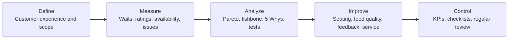
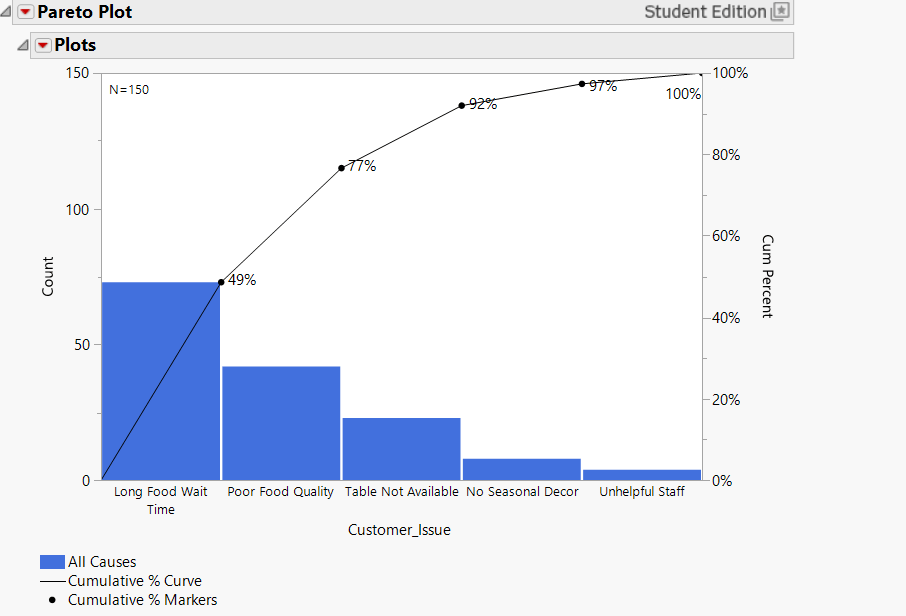
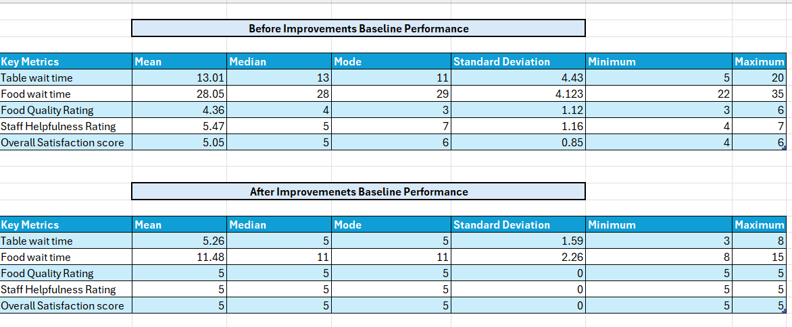
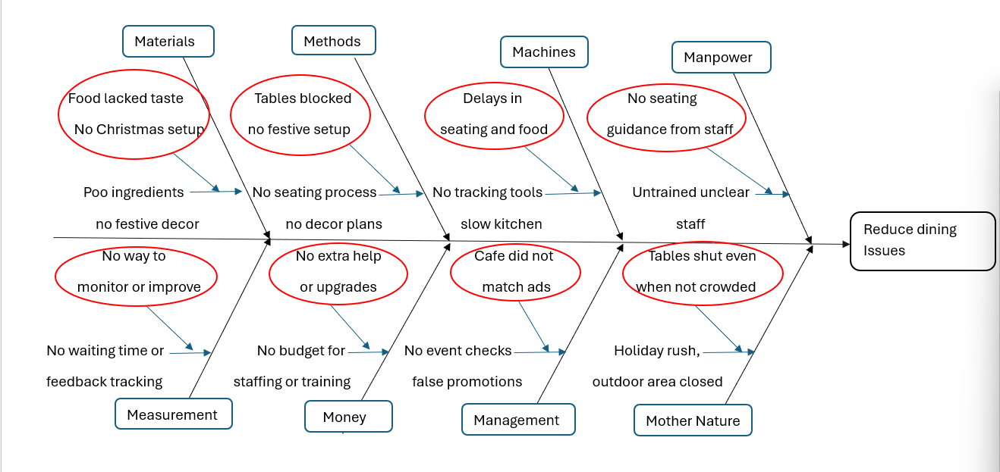

# Local Cafe Service Improvement | Six Sigma Case Study

**Focus:** Business Analytics & Operations Analytics · **Method:** DMAIC

## Business question

**How can service operations reduce customer wait times and improve consistency in a local cafe during peak periods?**

## Project overview

My role covered the analysis and documentation, using DMAIC to connect customer experience measures, root-cause analysis, proposed changes, and control planning. Excel supported the work; Pareto analysis, fishbone analysis, control charts, and hypothesis tests helped prioritize operational issues.

## DMAIC pipeline



## Key findings

- Food wait time and food quality were the leading complaint themes in the report’s Pareto analysis.
- Root-cause analysis highlighted gaps in seating coordination, service tracking, staff guidance, and peak-period planning.
- The proposed response combined clearer seating plans, food-quality checks, QR feedback, service training, and a seasonal setup checklist.

### Customer issue prioritization



### Baseline and pilot summary



### Root-cause analysis



## Metrics and how to read them

### Business and operations KPIs

| KPI | Formula | Interpretation |
|---|---|---|
| Average table wait | `Sum of table-wait minutes ÷ customer records` | Typical time before seating; lower is faster service. |
| Average food wait | `Sum of food-wait minutes ÷ customer records` | Typical time from order to delivery; lower is faster fulfillment. |
| Issue share | `Issue records in category ÷ all issue records × 100` | Shows which complaint types account for the largest share. |
| Customer rating | `Sum of ratings ÷ number of responses` | Average reported experience; interpret only with a consistent rating scale. |
| Wait-time change | `(Baseline mean − pilot mean) ÷ baseline mean × 100` | Relative difference between two measurement periods; use only when collection methods and units align. |

The report lists average table wait of **13.01 minutes** and food wait of **28.05 minutes** at baseline. The scenario-based pilot table lists **5.26 minutes** and **11.48 minutes**, about **59.6%** and **59.1%** lower in the project data. These are illustrative differences rather than verified operating results. Rating scales also differ between stages, so the scores are not directly comparable.

### Analysis and quality metrics

| Measure | Meaning | Reported interpretation |
|---|---|---|
| Pareto cumulative share | Running total of issue-category counts as a share of all issue counts | Used to prioritize food waits and food quality for follow-up. |
| Control-chart limits | Process center line with statistically calculated upper and lower limits | Used to watch process stability and detect unusual variation over time. |
| Defect proportion (`p`) | `Defective observations ÷ inspected observations` | Tracks the share of observations that miss a defined standard; define the defect rule before monitoring. |
| Hypothesis-test p-value | Probability of results at least this extreme under the null hypothesis | Table availability test: **0.61**; staff-helpfulness regression: **0.1499**. Both exceed **0.05**, so this analysis did not find statistically significant evidence for those relationships. This does not prove there is no effect. |

### Model metrics

No predictive model was fitted, so AUC, precision, and forecast error do not apply.

## Recommendations

1. Track table and food waits with consistent start/end definitions.
2. Assign clear seating ownership and show which tables are ready for guests.
3. Monitor food-quality checks and customer feedback by shift.
4. Prepare staffing, seating, and seasonal setup before peak periods.
5. Review weekly KPI and control-chart trends, then adjust the process when signals persist.

## Data and interpretation

The baseline uses a **150-record judgmental sample** built for this analysis from a personal visit and scenario assumptions; the separate **150-record pilot** is also scenario-based. Neither represents cafe transaction-system data. The pilot values do not establish realized savings or validated operational impact. Consistent observed samples and shared rating scales would be needed to validate the proposed changes.

## Project files

- `data/baseline_dataset.xlsx` — baseline sample data.
- `data/pilot_dataset.xlsx` — pilot sample data.
- `data/hypothesis_testing.xlsx` — supporting statistical test outputs.
- `analysis/jmp/` — five JMP journals for Pareto and control-chart analysis.

## Repository structure

```text
README.md
data/
├── baseline_dataset.xlsx
├── hypothesis_testing.xlsx
└── pilot_dataset.xlsx
analysis/
└── jmp/
    ├── imr_control_chart.jrp
    ├── np_control_chart.jrp
    ├── p_control_chart.jrp
    ├── pareto_issue_analysis.jrp
    └── xbar_r_control_chart.jrp
data_visualization_and_analysis/
├── baseline-and-pilot-summary.png
├── customer-issue-pareto.png
└── root-cause-fishbone.png
```

